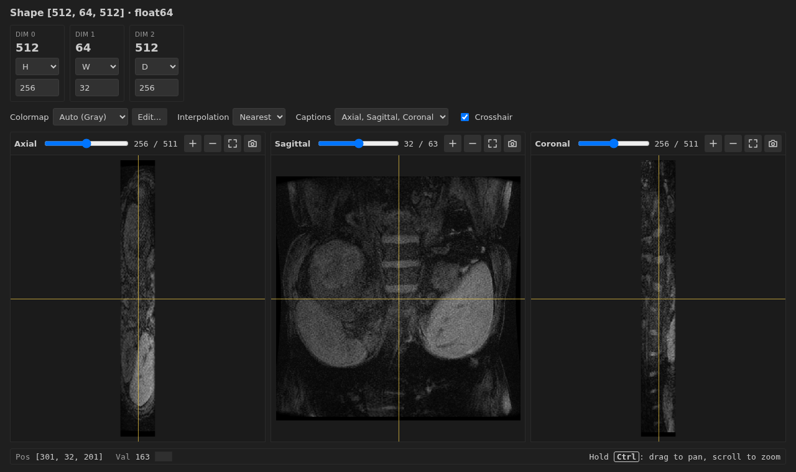
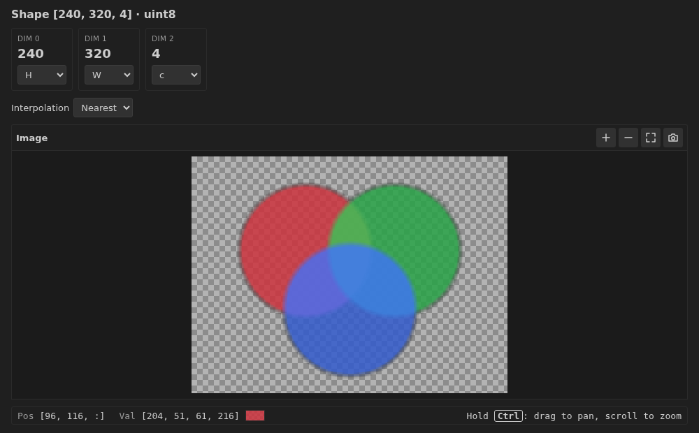
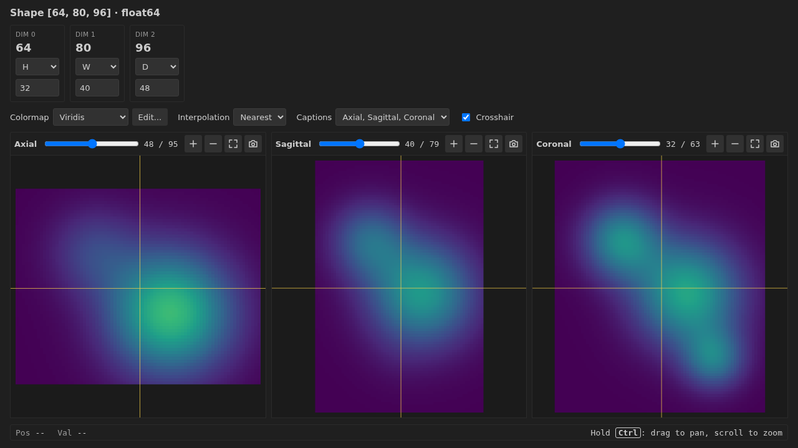
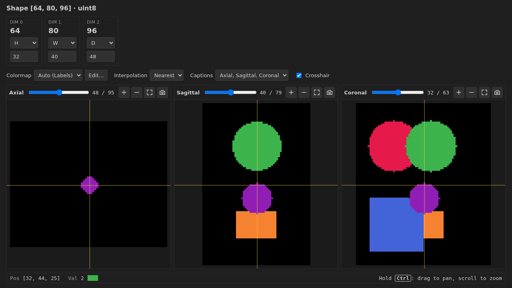
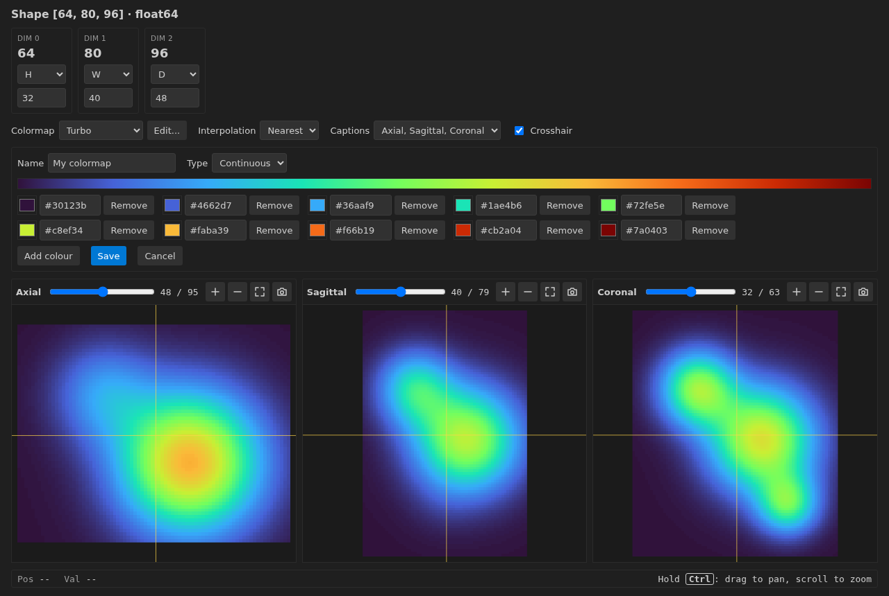

# DebugSlicer

Look at the images and volumes in your Python code while it is paused in the debugger, without writing a single temporary `matplotlib` plot.

DebugSlicer is a multipurpose viewer for debugging processing steps. It works with ordinary 2D images (mono, RGB, RGBA) and with 3D volumes, including MRI and CT scans. Right-click a variable, and it opens in its own tab.



## Raw data, shown as it is

DebugSlicer shows you what is actually in the array, because that is what you need when looking for a bug:

- **No resampling.** One array element is one pixel. Nothing is resized, reoriented or re-gridded before it is drawn.
- **No interpolation of the data.** The default display uses nearest-neighbour, so you see every voxel when you zoom in. The optional Bilinear setting only smooths the picture on screen.
- **The readout is always the real value**, taken straight from the array.
- **No metadata is applied.** Voxel spacing and orientation are ignored, so a volume with thick slices looks squashed along that axis rather than being corrected.

## Requirements

- A Python debug session using the Python Debugger (`debugpy`), running on the same machine as VS Code.
- `numpy` installed in the environment being debugged.

## Getting started

1. Pause your program at a breakpoint or on an exception.
2. In the **Variables** pane, right-click a variable and choose **View with DebugSlicer**.

The menu item appears for these types:

| Library | Types |
|---|---|
| NumPy | `ndarray` |
| PyTorch | `Tensor`, `Parameter` (moved to the CPU and detached for you) |
| Pillow | `Image`, and file-based images such as `PngImageFile` |

Each variable gets its own tab, named after it. If you reopen the same variable later, even in a new debug run, it returns to its existing tab with the new data and keeps your axis settings when the shape hasn't changed.

## Choosing what each dimension means

Every dimension of the array has a column showing its size and what it is used for:

| Role | Meaning |
|---|---|
| `H` | Image rows |
| `W` | Image columns |
| `D` | Depth: the slice axis of a volume |
| `c` | Colour channels |
| `const` | Held at the index you type underneath |

Sensible roles are chosen for you. A dimension of size 1 starts as a constant at 0, and a last dimension of size 3 or 4 in a 3-dimensional array is treated as colour. You can change any of them. `H`, `W`, `D` and `c` each belong to one dimension, so picking one that is already taken swaps the two.

Constants are useful for arrays with extra dimensions, such as a batch of images: set the batch dimension to `const` and type which image to show.

## Viewing a volume

When `H`, `W` and `D` are all assigned, three linked views open, each with a slider for its slice:

| View | Rows × columns | Slices along |
|---|---|---|
| Axial | `H` × `W` | `D` |
| Sagittal | `D` × `H` | `W` |
| Coronal | `D` × `W` | `H` |

The names are only labels, since orientation data isn't used. The **Captions** setting switches them to `H×W`, `D×H` and `D×W`, which is often clearer for data that isn't a scan.

## Mouse controls

| Action | Result |
|---|---|
| Drag or click in a view | Move the crosshair, which moves the slices in the other views |
| **Ctrl** + drag | Pan |
| **Ctrl** + scroll | Zoom |

On a Mac, Cmd works the same as Ctrl. The buttons above each view zoom in, zoom out, fit the image to the view, and take a screenshot. The **Crosshair** checkbox hides or shows the lines.

## Reading values

The bar at the bottom shows the position and value under the cursor, whichever view it is in, with a small swatch of the colour that value is drawn in. For colour images it lists every channel, with `:` in the position to mark the colour dimension.

## Colour images

A 2D image with a colour dimension of 2 to 4 values is shown in colour: gray + alpha, RGB or RGBA. Transparent areas show a gray checkerboard.



8-bit data is used as it is, floats already between 0 and 1 are treated as that range, and anything else is stretched to the range of the array. Colour only applies to 2D images: while `D` is assigned, `c` acts as a constant, so you can look at one channel of a volume at a time.

## Colormaps

Without colour channels, values are drawn through a colormap. The brightness range comes from the whole array, so it doesn't jump as you move between slices, and all three views agree.



**Auto** picks one for you: **Labels** for data with up to 64 distinct whole numbers, and **Gray** otherwise. The presets are:

| Preset | Type | Good for |
|---|---|---|
| Gray | Continuous | Images and scans |
| Viridis, Magma, Turbo | Continuous | Seeing small differences in continuous values |
| Cool-warm | Continuous | Signed data, such as differences |
| Labels | Step | Segmentations |

With **Labels**, 0 stays black as the background and every other label gets its own unique colour, however large or far apart the label values are. This also works for segmentations stored as floats, as they are after nibabel's `get_fdata()`.



NaN and infinite values are always drawn in magenta, so they can't be mistaken for real data.

### Your own colormaps

Choose **Edit...** to create a colormap from the current one, or to change one you saved. Pick or type the colours, and choose the type:

- **Continuous** blends evenly between the colours.
- **Step** gives each label one colour in order, repeating if there are more labels than colours. Data that isn't labels is cut into equal bands instead.



Saved colormaps are available in every tab and every workspace.

## Screenshots

The camera button above a view copies it to the clipboard as an image, exactly as shown, including zoom, pan and interpolation but without the crosshair. A message confirms the copy.

## Large arrays

Arrays are loaded completely into memory. If one is too large to load, DebugSlicer asks the debugger to save it again at a smaller type, for example `float64` as `float32`, and shows a warning in the tab saying what changed.

## Limitations

- Python only, and the debugged process must be able to write to a folder the extension can read.
- Colour is shown for 2D images only.
- Arrays are a snapshot: after stepping in the debugger, reopen the variable to see its new value.

## Planned

- Opening `.npy` and NIfTI files directly from the Explorer.
- An optional 3D render of volumes, as voxels or smoothed surfaces.

## Development

```bash
npm install
npm run compile      # type-check, lint and bundle
npm run test:unit    # logic tests
npm test             # tests inside VS Code
```

Press F5 with the **Run Extension** launch configuration to open `test_project/` in a development window, then debug `test.py` or `test_colormaps.py` there.
